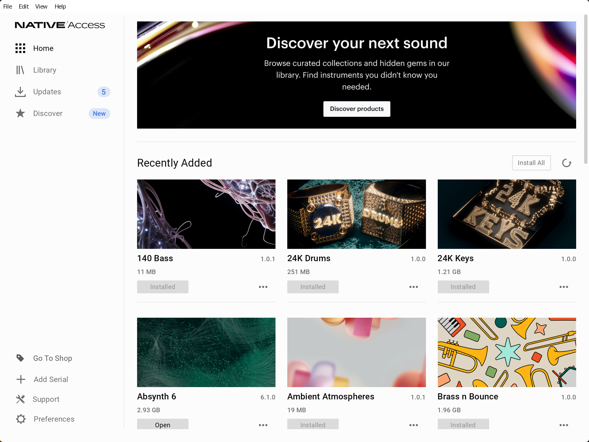

# Native Access 2 & Kontakt 8 on Linux

[Native Access](https://www.native-instruments.com/en/specials/native-access-2/)
under Wine, set up with one command. Products install from Native Access
as on Windows, Kontakt 8 included.



**This repository does NOT contain, grant access to, or distribute any
software from Native Instruments in any way.** It only provides scripts and
instructions for installing software you have legitimately obtained from
Native Instruments and you need your own account to download and use
plugins and instruments.

## Install

### Arch

```sh
yay -S ni-wine
```

### NixOS

As a flake input, with home-manager:

```nix
inputs.ni-wine.url = "github:selimbucher/native-instruments";
# ...
home.packages = [ inputs.ni-wine.packages.${pkgs.system}.default ];
```

Or without: `nix profile install github:selimbucher/native-instruments`.

### Fedora

```sh
sudo dnf copr enable selimbucher/ni-wine
sudo dnf install ni-wine
```

### Ubuntu (24.04 / 26.04) and Mint 22

```sh
sudo dpkg --add-architecture i386   # Ubuntu 24.04 only
wget -qO- https://dl.winehq.org/wine-builds/winehq.key | sudo gpg --dearmor -o /etc/apt/keyrings/winehq-archive.key
source /etc/os-release
sudo wget -NP /etc/apt/sources.list.d/ https://dl.winehq.org/wine-builds/ubuntu/dists/$UBUNTU_CODENAME/winehq-$UBUNTU_CODENAME.sources
sudo add-apt-repository ppa:selimbucher/ni-wine
sudo apt update   # Mint only
sudo apt install ni-wine
```

## Usage

Start **Native Access** from your app launcher or run `native-access`. The
first start sets up the Wine prefix at `~/.wine-ni` and installs Native
Access into it. Installed plugins land in that prefix.

Do not launch with something like `wine "Native Access.exe"`.

More commands with `ni --help`.
Environment:
- `NI_WINE_PREFIX` (prefix location, default `~/.wine-ni`),
- `WINE` (wine binary override),
- `NI_WINE_DEBUG` (keep Wine debug output), `NI_WINE_SCALE` (Native Access UI scale, default `GDK_SCALE`; `1` turns it off).

### Linux DAWs (yabridge)

You need to use yabridge's development build, which has the fixes for Wine 10 and
newer. Its last release (5.1.1) would need Wine 9.21, which Native Access
doesn't run on.

- Arch: `yay -S yabridge-wine10-git yabridgectl-wine10-git`
- Fedora: `sudo dnf copr enable ycollet/audinux && sudo dnf install yabridge`
- NixOS: the `inputs.ni-wine.overlays.yabridge` overlay builds it against
  ni-wine's Wine (also set `inputs.ni-wine.inputs.nixpkgs.follows = "nixpkgs"`)
- Others: the [nightly build](https://nightly.link/robbert-vdh/yabridge/workflows/build/master)

Then:

```sh
yabridgectl add "$HOME/.wine-ni/drive_c/Program Files/Common Files/VST3"
yabridgectl sync
```

### Windows DAWs under Wine

To use the plugins in a DAW that runs in its own Wine prefix, close the
DAW and link its prefix:

```sh
ni link /path/to/daw-prefix
```

Then rescan plugins in the DAW. The DAW may ask to be activated again.
`ni unlink` undoes the link.

### Maschine MK3

Plug it in before starting Maschine or the DAW. SHIFT + CHANNEL switches
MIDI mode on and off, also with no NI software open. MIDI mode sends to the
MIDI port `Native Instruments: Maschine MK3 Ctrl MIDI` and uses the
templates from Controller Editor.

## Troubleshooting

If something goes wrong, `ni doctor --fix`. Native Access logs to
`~/.wine-ni/drive_c/users/Public/Documents/Native Instruments/Logs/`,
ni-wine to `~/.local/state/ni-wine/`. If that doesn't fix it,
[open an issue](https://github.com/selimbucher/native-instruments/issues)
with the `ni doctor` output.
